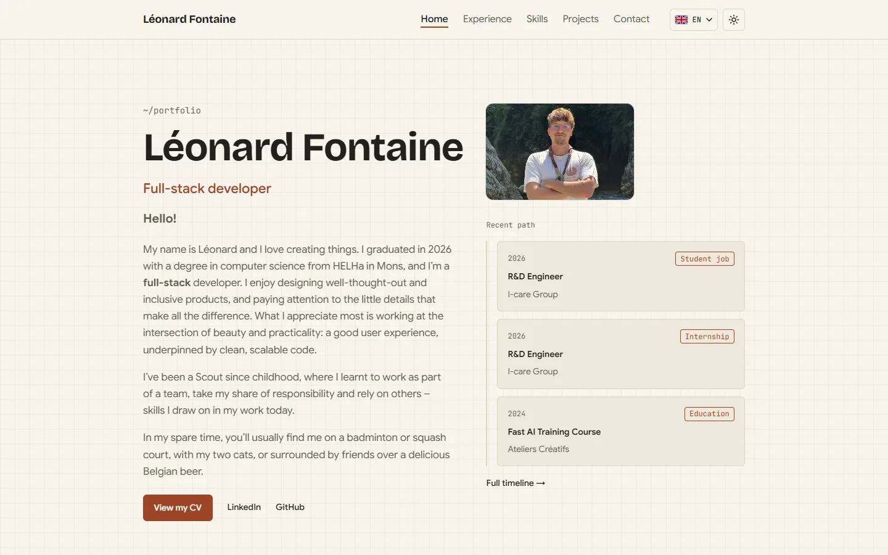
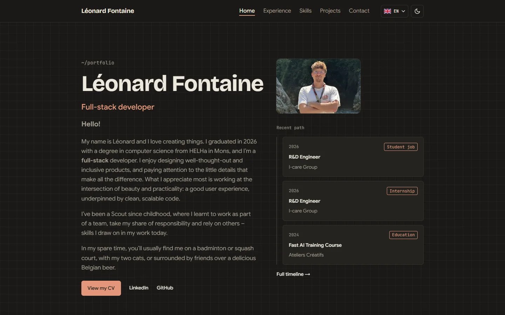
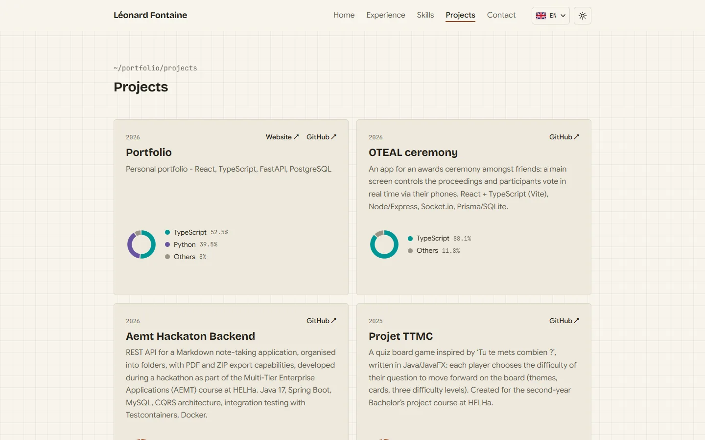

# Portfolio

Personal portfolio of **Léonard Fontaine**, full-stack developer based in Belgium —
live at **[leonard-fontaine.com](https://leonard-fontaine.com)**.

A trilingual site (French, English, Dutch) whose every text, experience, skill and project is edited
from a built-in admin, built with React, FastAPI and PostgreSQL and self-hosted on a small EU server.

| Light theme | Dark theme |
|---|---|
|  |  |



## Features

**For visitors**

- **Home** with photo, introduction and the latest steps of the career path; hovering the photo
  slides in the HTML that displays it.
- **Experience**: a vertical timeline of jobs, internships and education, each with a detail page.
- **Skills** grouped by category, with brand logos coloured to stay readable in both themes.
- **Projects** synchronised from GitHub, each card with a language breakdown chart.
- **Contact form** with spam protection; messages are saved and emailed to the owner.
- **French, English and Dutch**, chosen from the URL (`/fr`, `/en`, `/nl`); **light and dark themes**.
- **Accessible**: keyboard navigation, screen-reader labels, reduced-motion and high-contrast
  support, contrast checked against WCAG.
- **Fast and calm**: loading skeletons only when loading is slow, short entrance animations.

**For the owner (admin area)**

- Edit every text of the site in French; **English and Dutch are translated automatically by
  DeepL**, and any translation can be rewritten by hand.
- Upload the CV and the photo (cleaned of metadata on upload) and **choose the photo's framing** by
  dragging a frame.
- Add skills with logos picked from Simple Icons; order everything by hand.
- **Sync projects from GitHub** in one click, then choose which ones visitors see.
- Read contact messages in an inbox; old messages are deleted automatically after 12 months.

## How it works

```
Visitor ──HTTPS──▶ Caddy ──/api/…──▶ FastAPI (Python) ──▶ PostgreSQL
                     │                    ├──▶ DeepL API    (translation of admin texts)
                     │                    ├──▶ GitHub API   (project sync)
                     │                    └──▶ SMTP         (contact emails)
                     └── serves the built React app
```

- **Frontend**: a React + TypeScript single-page app (Vite, CSS Modules, React Router). Pages fetch
  their content from the API in the visitor's language.
- **Backend**: FastAPI in three layers — `api` (routes and schemas), `domain` (plain business
  entities and rules) and `infra` (database, email, external services). Translated fields are stored
  per language in PostgreSQL (JSONB); schema changes go through Alembic migrations.
- **Translation**: on save, empty English and Dutch fields are filled by DeepL. Markdown is converted
  to HTML for DeepL and back, so formatting survives the translation.
- **Projects**: the admin's sync reads the public repositories of the GitHub account (name, "About",
  languages, website) and keeps the admin's choices (visibility, title, order).
- **Hosting**: three Docker containers on one VPS in France — Caddy (HTTPS certificates, security
  headers, static files), the API and PostgreSQL, which has no route to the Internet. Nightly
  backups are kept on the server and copied to a PC; a restore has been tested.

## Security and privacy

- **No cookies for visitors, no trackers, no analytics, no visit logs**: the server does not record
  which pages are viewed or visitors' IP addresses. See the site's privacy page.
- Strict **Content-Security-Policy** (no inline script, no third-party resource), HSTS and the usual
  security headers; fonts and images are served by the site itself.
- Admin passwords hashed with **argon2**; session cookie `HttpOnly`, `Secure`, `SameSite`.
- **Rate limits** on admin sign-in and the contact form, counted per IPv4 address or IPv6 /64.
- Uploads are validated by content and size; the photo is re-encoded and stripped of metadata.
- Admin texts are rendered as Markdown without raw HTML; logos are drawn from validated SVG paths.

## Tech stack

| | |
|---|---|
| Frontend | React 19, TypeScript, Vite, React Router, CSS Modules, Vitest + Testing Library |
| Backend | Python 3.12, FastAPI, SQLAlchemy (async), Alembic, Pydantic, Pillow, pytest |
| Data | PostgreSQL 17 |
| Services | DeepL API (translation), GitHub REST API (projects), SMTP (email) |
| Hosting | Docker Compose, Caddy, Ubuntu 24.04 on an OVHcloud VPS (France) |
| Tooling | uv, npm, Ruff, oxlint, Prettier, Playwright (visual checks) |

## Deployment

The production stack is in [`deploy/`](deploy/) (Compose file, Caddyfile, backup and restore scripts).
The step-by-step runbook — first install, updates, backups, restore, troubleshooting — is
[`docs/deployment.md`](docs/deployment.md) (in French); the checklist is
[`docs/deployment-checklist.md`](docs/deployment-checklist.md).

## Project structure

```
backend/    FastAPI app (app/api, app/domain, app/infra), Alembic migrations and tests
frontend/   React app (Vite)
deploy/     production stack: Compose file, Caddyfile, backup and restore scripts
docs/       deployment runbook and checklist, README images
specs/      one specification per feature
tasks/      implementation plan of the feature in progress
docker-compose.yml   local PostgreSQL + Mailpit
```

### Backend layers

| Layer | Contains | May import |
|---|---|---|
| `app/api/` | Routes, request/response schemas (Pydantic), FastAPI dependencies | `domain`, `infra` |
| `app/domain/` | Entities (plain dataclasses) and business rules | nothing from the app, no FastAPI or SQLAlchemy |
| `app/infra/` | Settings, database engine, ORM models, repositories, email | `domain` |

ORM models and domain entities are separate classes; repositories convert between them.

## Prerequisites

- [Docker Desktop](https://www.docker.com/products/docker-desktop/)
- [uv](https://docs.astral.sh/uv/) (Python 3.12 is installed automatically by uv)
- [Node.js](https://nodejs.org/) 22+

## Run locally

1. Start the database and the fake mail server:

   ```bash
   docker compose up -d
   ```

   Mailpit inbox: <http://localhost:8025>

2. Start the backend (<http://localhost:8000>, API docs at <http://localhost:8000/docs>):

   ```bash
   cd backend
   cp .env.example .env        # local settings, never committed
   uv sync
   uv run alembic upgrade head # create or update the database schema
   uv run fastapi dev app/main.py
   ```

   `GET /api/health` reports whether the database is reachable (200, or 503 when it is down).

3. Start the frontend (<http://localhost:5173>), in another terminal:

   ```bash
   cd frontend
   npm install
   npm run dev
   ```

## Quality checks

| | Backend (`backend/`) | Frontend (`frontend/`) |
|---|---|---|
| Lint | `uv run ruff check .` | `npm run lint` |
| Format | `uv run ruff format .` | `npm run format` |
| Tests | `uv run pytest` | `npm test` |

Backend tests need the Docker database running. They create and use a separate `portfolio_test` database; each test is rolled back, so the development data is never touched.

## Database migrations

Every schema change goes through an Alembic migration (from `backend/`):

```bash
uv run alembic revision --autogenerate -m "create home_content table"  # after changing ORM models
uv run alembic upgrade head    # apply all pending migrations
uv run alembic downgrade -1    # undo the last one
```

Review each generated file in `migrations/versions/` before committing it. A test checks that all migrations can be undone and re-applied.

## Git workflow

- `main`: stable, deployed version
- `develop`: integration branch
- `feature/<name>`: one branch per feature, merged into `develop`
- Commit messages follow [Conventional Commits](https://www.conventionalcommits.org/)
